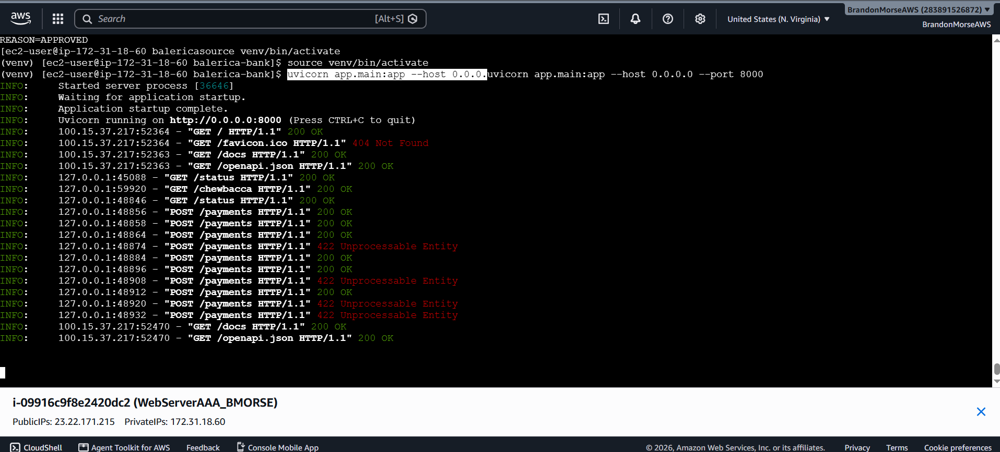
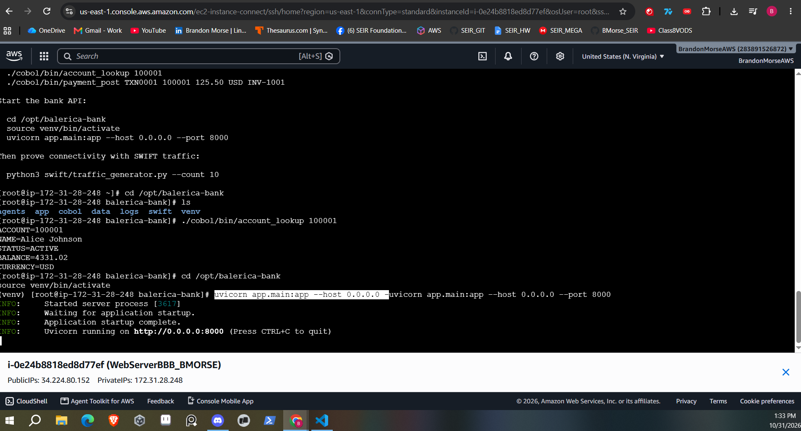
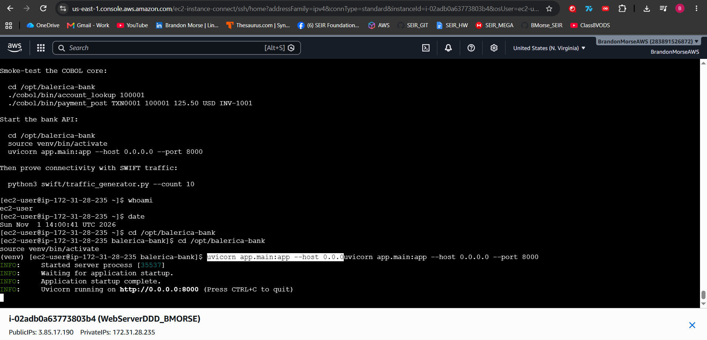
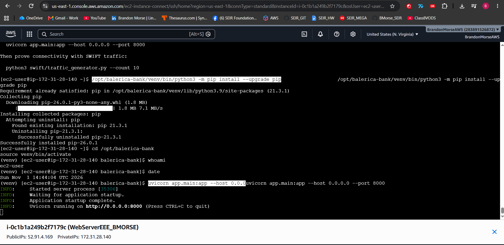
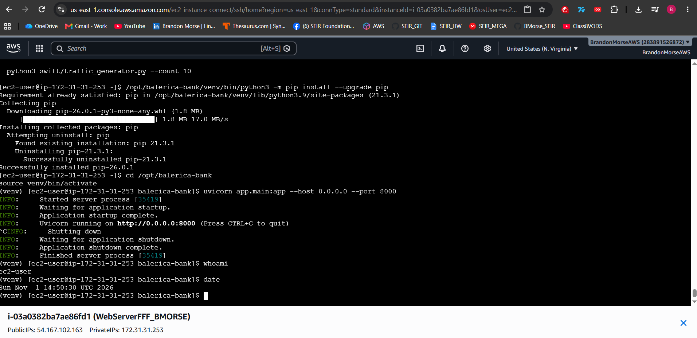
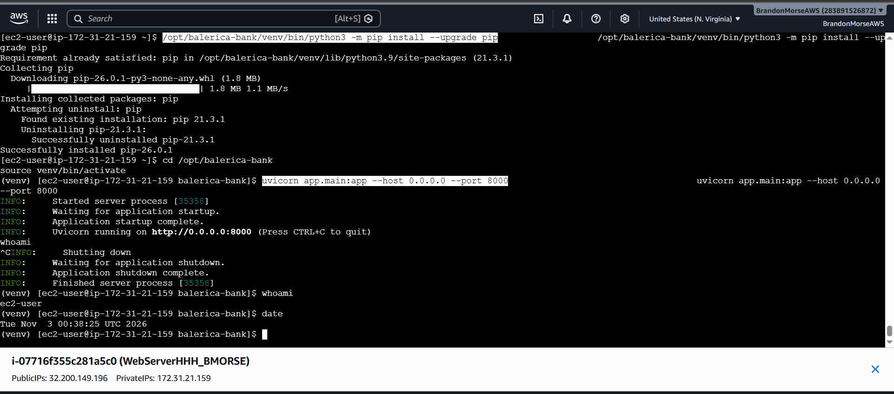
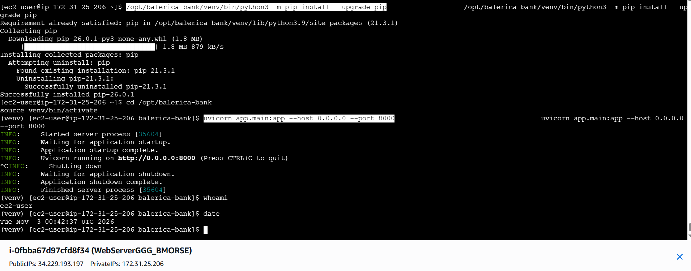

| Run | Date| Time Zone | Instance ID | Boot Time UTC |Public IPv4 DNS | Screenshot | Terminated?
| -------- | -------- | -------- | ------ | ----- | ----- | ----- | ------ |
| 1  | 10/31/2026  | EST  | i-09916c9f8e2420dc2 | 11:37:16 UTC | 23.22.171.215 | | No 
| 2  | 10/31/2026  | EST  | i-0e24b8818ed8d77ef | 13:12:21 UTC | 34.224.80.152 |  | No
| 3  | 11/01/2026  | EST  | i-02adb0a63773803b4 | 08:47:09 UTC | 3.85.17.190 |  | No
| 4  | 11/01/2026  | EST  | i-0c1b1a249b2f7179c | 09:34:41 UTC | 52.91.4.169 |  | No
| 5  | 11/01/2026  | EST  | i-03a0382ba7ae86fd1 | 09:35:39 UTC | 54.167.102.163 |  | No
| 6  | 11/02/2026  | EST  | i-09916c9f8e2420dc2 | 11:37:16 UTC | 23.22.171.215 |  | No
| 7  | 11/02/2026  | EST  | i-09916c9f8e2420dc2 | 11:37:16 UTC | 23.22.171.215 |  | No
